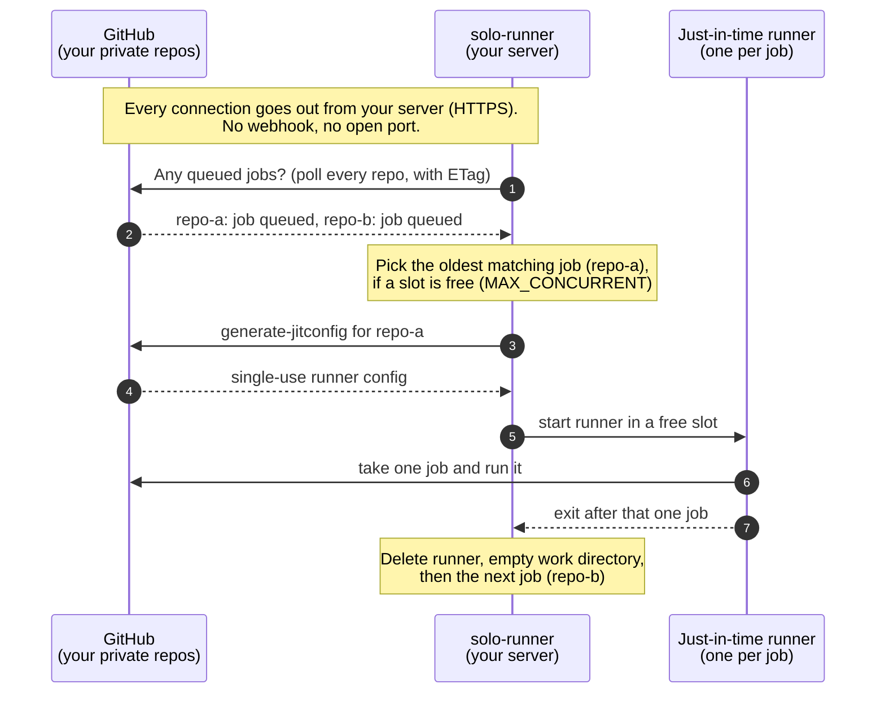

# solo-runner

[](https://github.com/sebiweise/solo-runner/actions/workflows/ci.yml)
[](https://github.com/sebiweise/solo-runner/actions/workflows/e2e.yml)
[](https://sonarcloud.io/summary/new_code?id=sebiweise_solo-runner)
[](https://github.com/sebiweise/solo-runner/releases/latest)
[](https://github.com/sebiweise/solo-runner/pkgs/container/solo-runner)
[](pyproject.toml)
[](LICENSE)

**Self-hosted GitHub Actions runners for all the private repos of a personal
account, from one container, without a GitHub organisation.**

GitHub only offers shared runners to organisations: on a personal account a
runner belongs to exactly one repository. With ten repos that means ten
runners, all idle most of the time, all able to run a job at once on the same
small server. solo-runner turns that around. It watches every repo for queued
jobs and starts a fresh, single-use runner for whichever job has waited
longest, never more than `MAX_CONCURRENT` at a time.


The step-by-step flow is in [How it works](#how-it-works).

- **No organisation needed.** Works with repos owned by your user account.
- **One container.** `docker compose up -d` with a token. No Kubernetes, no
  cloud account, no webhook, no open port.
- **Global limit.** `MAX_CONCURRENT=1` means one job on this host at a time,
  across all repos. The rest wait in GitHub's queue, as they would for a busy
  runner.
- **Fresh runner per job.** Every job gets a just-in-time runner that GitHub
  removes after one job, and an empty work directory.
- **Finds your repos itself.** `REPOS=auto` serves every private repo the
  token can see. Public repos are refused by default.
- **PAT or GitHub App**, standard library Python only, amd64 and arm64.

## Contents

- [Security](#security) (read this first)
- [Quick start](#quick-start)
- [Configuration](#configuration)
- [Settings per repo](#settings-per-repo)
- [PAT or GitHub App](#pat-or-github-app)
- [Jobs that use Docker](#jobs-that-use-docker)
- [Monitoring](#monitoring)
- [Bring your own runner image](#bring-your-own-runner-image)
- [How it works](#how-it-works)
- [How it compares](#how-it-compares)
- [Troubleshooting](#troubleshooting)

## Security

A self-hosted runner runs whatever code the workflow tells it to. Decide what
you trust before you start.

- **Private repos only.** On a public repo, a pull request from a fork can run
  its code on your runner. solo-runner skips public repos unless you set
  `ALLOW_PUBLIC_REPOS=true`, and logs a warning for each one it skips (once,
  when it first sees it). Public repos get GitHub-hosted runners for free
  anyway.
- **The Docker socket is root on the host.** Without it (the default), a job
  runs as the unprivileged `runner` user inside the container. With
  `/var/run/docker.sock` mounted, any job can start a privileged container and
  own the host. Only mount it on a machine that runs nothing else, such as a
  small VPS used for CI alone. Rootless Docker or Sysbox reduce the risk.
- **Your token stays out of jobs.** The dispatcher reads `GITHUB_TOKEN` and
  removes it from the environment before any runner starts. A job with the
  Docker socket can still read it from the container's configuration
  (`docker inspect`). Prefer `GITHUB_TOKEN_FILE` (a mounted secret), and a
  GitHub App, whose tokens expire after an hour.
- **Least privilege.** A fine-grained PAT limited to the repos you want to
  serve, with *Administration: Read and write* and *Actions: Read*, and an
  expiry date.
- **Metrics are readable by every job.** With `METRICS_PORT` set, the
  dispatcher answers `GET /metrics` without authentication. Jobs run in the same
  container, so any job can read it on `localhost`, and so can anything that
  reaches the published port. It contains the names of all served repos, how
  many jobs each one ran and is waiting for, and API error counts; no tokens,
  job names or logs. Publish the port on `127.0.0.1` or a private network only
  (`127.0.0.1:9464:9464`), and leave `METRICS_PORT` unset if one repo must not
  learn the names of the others.
- **Shared tool cache.** The optional `toolcache` volume is shared between
  repos. Leave it out if one repo must not see what another one installed.
- **The config file is readable by jobs.** A `CONFIG_FILE` mounted into the
  container can be read by every job, like any other file there. It holds
  repo names, labels and limits only; never put a token or other secret in
  it. Mount it read-only (`:ro`), so a job cannot change the settings of other
  repos for the next start.

Report vulnerabilities as described in [SECURITY.md](SECURITY.md).

## Quick start

1. **Token.** GitHub → Settings → Developer settings → Fine-grained tokens →
   Generate. *Repository access*: only the private repos to serve.
   *Repository permissions*: **Administration: Read and write** (registers the
   runners) and **Actions: Read** (finds queued jobs).
2. **Start it** on a Linux host with Docker:
   ```bash
   mkdir solo-runner && cd solo-runner
   curl -fsSLO https://raw.githubusercontent.com/sebiweise/solo-runner/main/compose.yaml
   curl -fsSL https://raw.githubusercontent.com/sebiweise/solo-runner/main/.env.example -o .env
   chmod 600 .env && vi .env        # GITHUB_TOKEN=..., LABELS=solo
   docker compose up -d
   docker compose logs -f           # "serving N repos"
   ```
3. **Point a workflow at it.** A job is taken when every label it asks for is
   one the runner has, including all of `LABELS`:
   ```yaml
   jobs:
     build:
       runs-on: [self-hosted, solo]   # or just: solo
   ```
   To move repos without touching workflows, use a repository variable with a
   fallback, `runs-on: ${{ vars.LINUX_RUNNER || 'ubuntu-latest' }}`, and set
   `LINUX_RUNNER=solo` in each repo that should use the runner. Deleting the
   variable sends its jobs back to GitHub.

Within `POLL_INTERVAL` seconds of a push, the log shows
`owner/repo: next job ...` and `started runner ...`.

## Configuration

All settings are environment variables. Secrets can also be read from a file
with the `_FILE` suffix (`GITHUB_TOKEN_FILE`, `GITHUB_APP_PRIVATE_KEY_FILE`).

| Variable | Default | Meaning |
| --- | --- | --- |
| `GITHUB_TOKEN` | – | Fine-grained or classic PAT. `ACCESS_TOKEN` works too. |
| `GITHUB_APP_ID` | – | GitHub App instead of a PAT, with `GITHUB_APP_PRIVATE_KEY_FILE`. |
| `GITHUB_APP_INSTALLATION_ID` | auto | Only needed if the app has more than one installation. |
| `REPOS` | `auto` | `auto`, or a list of `owner/repo` separated by spaces or commas. |
| `REPO_EXCLUDE` | – | Glob patterns matched against `owner/repo` and `repo`, e.g. `*-archive`. |
| `ALLOW_PUBLIC_REPOS` | `false` | Serve public repos too. Read [Security](#security) first. |
| `LABELS` | – | Extra labels. Jobs must ask for all of them (strongly recommended, so the runner only takes jobs meant for it). `self-hosted`, `linux` and the architecture (`x64`/`arm64`) are always set. |
| `MAX_CONCURRENT` | `1` | Jobs running at the same time on this host, across all repos. |
| `POLL_INTERVAL` | `30` | Seconds between two scans (minimum 5). |
| `IDLE_TIMEOUT` | `300` | Seconds a runner waits for its job before it is removed. |
| `DISCOVERY_INTERVAL` | `600` | Seconds between two reads of the repo list. |
| `HEARTBEAT_URL` | – | URL fetched after each successful scan, at most once a minute. |
| `METRICS_PORT` | – | Serve Prometheus metrics on this port at `/metrics`. Off when unset. See [Monitoring](#monitoring). |
| `METRICS_ADDR` | `0.0.0.0` | Address the metrics endpoint listens on inside the container. |
| `LOG_FORMAT` | `text` | `text` or `json` (one object per line, runner output included). |
| `RUNNER_TRACE` | `false` | Also log the runner's internal trace (`[RUNNER ...]`/`[WORKER ...]` lines, thousands per job). For debugging the runner itself. |
| `RUNNER_NAME_PREFIX` | `solo-runner` | Runner names are `<prefix>-<repo>-<time>-<slot>`. Give each host its own prefix if several run against the same repos. |
| `WORK_DIR` | `/srv/solo-runner/work` | Job work directories, one per slot, emptied after every job. |
| `RUNNER_DIR` | `/home/runner` | Where the runner installation lives (for custom images). |
| `GITHUB_API_URL` | `https://api.github.com` | For GitHub Enterprise Server. |
| `CONFIG_FILE` | – | Optional YAML file with [settings per repo](#settings-per-repo). |

**Rate limit.** Each scan costs about two requests per repo, but unchanged
answers come back as `304 Not Modified`, which GitHub does not count. Ten repos
at `POLL_INTERVAL=30` stay far below the 5,000 requests per hour of a PAT.
With many repos, raise `POLL_INTERVAL` or exclude repos without workflows.

## Settings per repo

The environment variables apply to every repo. To give single repos their own
labels or their own limit, write a `config.yaml` and point `CONFIG_FILE` at it:

```yaml
# config.yaml: only what differs from the environment
repos:
  me/heavy-build:          # owner/repo
    max_concurrent: 1      # never more than one job of this repo at a time
    labels: [solo, bigdisk]
  "*-sandbox":             # glob, matched against owner/repo and repo
    labels: [sandbox]      # quote patterns that start with *
```

```yaml
# compose.yaml
    environment:
      CONFIG_FILE: /etc/solo-runner/config.yaml
    volumes:
      - ./config.yaml:/etc/solo-runner/config.yaml:ro
```

- **`labels`** replaces `LABELS` for the repo: the runner registers with
  `self-hosted`, `linux`, the architecture and these labels, and takes only jobs
  that ask for all of them.
- **`max_concurrent`** limits how many runners the repo gets at once. The
  global `MAX_CONCURRENT` still applies on top, so a value above it has no
  effect. While a repo is at its limit, its jobs wait and younger jobs of other
  repos go first.
- A setting left out keeps the value from the environment. Which repos are
  served is still decided by `REPOS` and `REPO_EXCLUDE` alone; an entry that
  matches no served repo is logged.
- Keys are compared without case. If several entries match a repo, the first
  one in the file wins. Unknown keys are an error, so a typo stops the start
  instead of being ignored.
- The file is read once at start: `docker compose restart` after a change.

The dispatcher has no dependencies besides Python, so it reads a strict subset
of YAML: mappings, lists (`[a, b]` or `- a` lines), quoted and plain values and
comments. Anchors, multi-line strings and the like are refused with a line
number; what it accepts means the same in any YAML parser.

## PAT or GitHub App

**Fine-grained PAT**: simplest. It sees exactly the repos you select, and
`REPOS=auto` serves those. It expires: put a reminder in your calendar.

**GitHub App**: tokens are short-lived and the app is not tied to your user
session.

1. Settings → Developer settings → GitHub Apps → New GitHub App. Name it, set
   any homepage URL, **untick Webhook → Active**.
2. *Repository permissions*: **Administration: Read and write**,
   **Actions: Read**. *Where can this app be installed*: only this account.
3. Create it, note the **App ID**, and generate a **private key** (`.pem`).
4. *Install App* → your account → only the repos to serve.
5. Mount the key and configure:
   ```yaml
   environment:
     GITHUB_APP_ID: "123456"
     GITHUB_APP_PRIVATE_KEY_FILE: /run/secrets/app.pem
   volumes:
     - ./app.pem:/run/secrets/app.pem:ro   # readable by uid 1001
   ```

## Jobs that use Docker

Many workflows run `docker build`, `docker run`, `docker compose` or use
`services:`. The image contains the Docker CLI, buildx and the compose plugin;
to use the host's daemon:

```yaml
    volumes:
      - /var/run/docker.sock:/var/run/docker.sock
      - /srv/solo-runner/work:/srv/solo-runner/work
    group_add:
      - "999"   # getent group docker | cut -d: -f3
```

```bash
sudo install -d -o 1001 -g 1001 /srv/solo-runner/work
```

The work directory is mounted at the **same path** inside and outside the
container: the host's daemon resolves a job's `docker run -v "$PWD:/src"`
against the host's file system. Jobs with a `container:` key do not work this
way (the runner mounts its own `externals` directory, which exists only inside
the container); keep those on GitHub-hosted runners.

Disk fills up with images. A daily cron job helps:

```bash
17 4 * * * docker system prune -af --filter until=72h >/dev/null
```

## Monitoring

- **Logs**: `docker compose logs`. `LOG_FORMAT=json` for Loki, Elastic and the
  like.
- **Heartbeat**: create a heartbeat monitor (Better Stack, Healthchecks.io,
  Uptime Kuma push monitor, ...) with a 5-minute period and set
  `HEARTBEAT_URL`. It goes quiet when the container is down or hung, or when
  GitHub rejects the token.
- **Prometheus**: set `METRICS_PORT=9464`, publish the port (see the comment
  in `compose.yaml`) and scrape `http://<host>:9464/metrics`. Read the
  [Security](#security) note first.

| Metric | Type | Meaning |
| --- | --- | --- |
| `solo_runner_slots_max`, `_busy`, `_free` | gauge | `MAX_CONCURRENT`, runners that exist now, slots left. |
| `solo_runner_repos_served` | gauge | Repos being polled. |
| `solo_runner_jobs_queued{repo}` | gauge | Matching queued jobs in the last scan. While all slots are busy, no scan runs and the value is not updated. |
| `solo_runner_last_scan_timestamp_seconds` | gauge | Last scan in which every repo answered. |
| `solo_runner_runners_started_total{repo}` | counter | Just-in-time runners registered. |
| `solo_runner_jobs_started_total{repo}` | counter | Jobs a runner picked up. |
| `solo_runner_jobs_finished_total{repo}` | counter | Jobs whose runner exited after running them (success or failure of the job itself is not known to solo-runner). |
| `solo_runner_runners_idle_total{repo}` | counter | Runners removed after `IDLE_TIMEOUT` without a job. |
| `solo_runner_runner_errors_total{repo}` | counter | Runners that failed to register or start. |
| `solo_runner_job_wait_seconds` | histogram | Time from a job being queued to a runner being started for it. |
| `solo_runner_github_requests_total{status}` | counter | API requests by HTTP status (`304` = cached, free) or `network`. |
| `solo_runner_github_errors_total{status}` | counter | Failed API requests (status 400 and above, or `network`). |
| `solo_runner_github_rate_limit_remaining` | gauge | `X-RateLimit-Remaining` of the last answer. |
| `solo_runner_info{version}` | gauge | Always 1. |

Example alerts: `time() - solo_runner_last_scan_timestamp_seconds > 600`
(dispatcher stuck or token rejected), `rate(solo_runner_github_errors_total[15m]) > 0`,
`histogram_quantile(0.9, rate(solo_runner_job_wait_seconds_bucket[1h])) > 1800`
(jobs wait long: raise `MAX_CONCURRENT`).

## Bring your own runner image

The bundled image is the official `ghcr.io/actions/actions-runner` plus
Python and the Docker compose plugin. Like that image, it has far fewer tools
than GitHub's hosted runners: install what a job needs in the workflow
(`sudo apt-get install -y ...` or a `setup-*` action), so it keeps working on
`ubuntu-latest` too. If your jobs need more preinstalled tools, build on another runner
image and copy the dispatcher in:

```dockerfile
FROM your/runner-image:tag
COPY --from=ghcr.io/sebiweise/solo-runner:0.2 /opt/solo-runner /opt/solo-runner
ENV PYTHONPATH=/opt/solo-runner RUNNER_DIR=/actions-runner
ENTRYPOINT ["python3", "-m", "solo_runner"]
```

It needs `python3` (3.10 or later) and the runner's `run.sh` in `RUNNER_DIR`.

## How it works

One cycle, from a queued job to a clean slot:



## How it compares

| Project | Fits when |
| --- | --- |
| [actions-runner-controller](https://github.com/actions/actions-runner-controller) | You run Kubernetes. |
| [GARM](https://github.com/cloudbase/garm) | You want VMs or LXD instances per job, across clouds. |
| [terraform-aws-github-runner](https://github.com/github-aws-runners/terraform-aws-github-runner) | You run on AWS. |
| [myoung34/docker-github-actions-runner](https://github.com/myoung34/docker-github-actions-runner) | One runner per repo is fine, without a shared limit. |
| [scalerunnergh](https://github.com/emon5122/scalerunnergh) | You prefer Go and runner scale sets, and list your repos by hand. |
| **solo-runner** | One small host, many personal repos, one container, minimal setup. |

## Troubleshooting

- **Job stays "Queued"**: the job's `runs-on` asks for a label solo-runner does
  not have, or misses one of `LABELS`; the
  repo is public, archived, excluded or not visible to the token (see the
  `serving N repos` line); all slots are busy; or the repo is at its
  `max_concurrent` from the config file, or has its own `labels` there.
- **`HTTP 401` / `403`**: the token expired or lacks a permission. `403` with
  "rate limit": raise `POLL_INTERVAL`.
- **`no job after 300s, stopping runner`**: the job was cancelled, or another
  runner took it. Harmless.
- **`Permission denied` under `/srv/solo-runner/work`**: the directory on the
  host must belong to uid 1001.
- **`permission denied ... docker.sock`**: `group_add` must be the host's
  docker group id.
- **Leftover offline runners** in a repo's settings: removed automatically at
  the next start if their name starts with `RUNNER_NAME_PREFIX`.

## Development

```bash
pip install pytest ruff
pytest -q
ruff check . && ruff format --check .
docker build -t solo-runner:dev .
```

An end-to-end test runs real jobs through the image against a private test
repo; see [CONTRIBUTING.md](CONTRIBUTING.md#end-to-end-test).

See [CONTRIBUTING.md](CONTRIBUTING.md). Releases: [CHANGELOG.md](CHANGELOG.md).

## License

[MIT](LICENSE)
