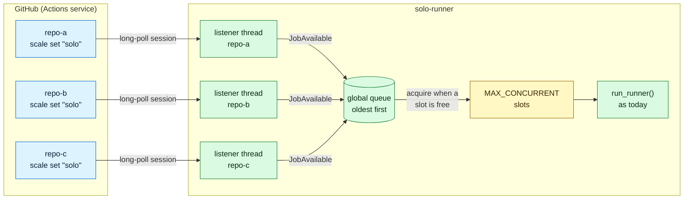

# Proposal: a runner scale set mode for v1.0

Status: **proposal, not built.** Written 2026-11-17 against
[`actions/scaleset`](https://github.com/actions/scaleset) at `716908e`
(2026-11-07, "Public Preview") and solo-runner 0.1.0. Spikes run on
2026-11-19/20; see [Spike results](#spike-results-2026-11-19) and the
[revised design](#revised-design-after-both-spikes), which replace parts of the
design below (there is no acquire step any more).

## Summary

GitHub's runner scale set API lets a client long-poll for jobs instead of
listing workflow runs, and lets GitHub do the job-to-runner matching. It works
for repos of a personal account, but only as **one scale set per repo**: there
is no account-wide scale set without an organisation. solo-runner would keep
its reason to exist (one container, one global limit, many repos), and gain
faster pickup, almost no REST traffic and exact job lifecycle events.

**Recommendation:** keep polling as the default for v1.0. Add the scale set
mode as an opt-in `MODE=scaleset`, marked experimental, but only after a short
spike against real GitHub answers the three open questions below. If the
spike fails on question 1 or 2, postpone the mode to 1.x and revisit when
`actions/scaleset` leaves public preview.

## How solo-runner works today

Every `POLL_INTERVAL` seconds the dispatcher lists queued and in-progress runs
of every repo, then their jobs (ETags keep most answers at 304), matches the
job's labels locally (`job_matches`), picks the oldest jobs for the free slots
(`pick_jobs`) and registers a just-in-time runner in that repo. GitHub then
hands *some* matching queued job of that repo to the runner; solo-runner learns
it got one by reading `Running job:` from the runner's output, and removes the
runner after `IDLE_TIMEOUT` if it never got one.

## What a scale set is

A scale set is a named group of ephemeral runners registered at repo, org or
enterprise level. Its name, plus optional extra labels (multiple labels are
supported on github.com; GHES needs 3.18+ and a feature flag), are what
`runs-on` targets. The client:

1. exchanges a PAT or App token for a registration token, then for an admin
   token of the Actions service (`POST /actions/runner-registration`, scoped
   to one config URL, i.e. one repo here);
2. creates or finds the scale set (unique name per runner group; a personal
   repo only has the `default` group);
3. opens a message session for it (one session per scale set at a time) and
   long-polls: the call is held ~50 s and returns `JobAvailable`,
   `JobAssigned`, `JobStarted`, `JobCompleted` messages plus current
   statistics. The client sends its free capacity with every poll
   (`X-ScaleSetMaxCapacity`) so GitHub does not hand it more than it can run;
4. acquires the jobs it wants (`AcquireJobs`); an unacquired job stays
   unassigned;
5. generates a JIT config for the scale set and starts a runner. GitHub
   assigns an acquired job to any idle runner of the set; the runner runs one
   job and is removed.

Messages are acknowledged by deleting them; unacknowledged ones are
redelivered. A job assigned to the set but not picked up by a runner in time
is requeued, up to three times.

## How it would map onto a personal account

- **Discovery stays.** `REPOS`, `REPO_EXCLUDE`, the public-repo refusal and
  `DISCOVERY_INTERVAL` work as now. For each served repo the dispatcher
  ensures a scale set named `RUNNER_NAME_PREFIX` with `LABELS` as extra labels,
  and runs one listener thread. Repos that leave the list get their session
  closed and their scale set deleted.
- **The global limit moves to acquisition.** Each listener reports
  `maxCapacity = free slots` (shared counter). `JobAvailable` messages from all
  repos go into one queue ordered by `queueTime`; a job is acquired only when a
  slot is reserved for it, so oldest-first across repos survives. Because each
  long poll carries the capacity of the moment it was sent (up to ~50 s old),
  the sum over N sessions can overshoot; the queue absorbs that by not
  acquiring, which is why open question 1 matters.
- **The runner part is reused.** `run_runner()` keeps its slot directory, runner
  copy, log pump and cleanup. Only the JIT call changes (scale set endpoint
  instead of `/repos/{repo}/actions/runners/generate-jitconfig`), and
  `JobStarted`/`JobCompleted` replace the `Running job:` heuristic.
- **Shutdown and restarts.** Sessions are deleted on SIGTERM; scale sets stay,
  so jobs queued while the container restarts are waiting for the set, not
  failing with "no runner matches". Stale sessions after `kill -9` expire on
  GitHub's side; at start a `409 Conflict` on session creation is retried.
- **Implementation in the standard library.** There is no Python SDK. The
  protocol is plain HTTPS + JSON (token exchange, scale set CRUD, sessions,
  messages, acquire, JIT config, runner removal), about 400 to 600 lines in a
  new `solo_runner/scaleset.py`, tested against a fake server like the current
  `github.py`. `actions/scaleset` is the reference to follow, and its changes
  have to be tracked by hand.

## Trade-offs

| | Polling (today) | Scale sets |
| --- | --- | --- |
| Pickup latency | up to `POLL_INTERVAL` (30 s) | ~1 s (long poll) |
| REST rate limit | ~2 requests per repo per scan, mostly free 304s | almost none; the Actions service is called with its own token |
| Who matches jobs to runners | solo-runner (`job_matches`), approximated | GitHub, exactly as for any runner |
| Wrong-job / idle runners | possible: a runner for repo-a takes *a* queued job, `IDLE_TIMEOUT` cleans up | none: runners only start for acquired jobs |
| Job lifecycle | log line heuristic | `JobStarted` / `JobCompleted` with result; good input for metrics (backlog item 4) |
| Open connections | none between scans | one long poll per served repo (threads; fine for tens of repos) |
| Global `MAX_CONCURRENT`, oldest first | simple, exact | must be rebuilt on acquire; overshoot possible, see above |
| What appears in repo settings | short-lived JIT runners | one scale set per repo, permanently |
| Several hosts on the same repos | works with distinct prefixes | works: each host has its own set, both carry label `solo` |
| API status | documented REST API | Actions service API, "stable" per `actions/scaleset`, repo in public preview |
| Permissions | Administration RW + Actions R | Administration RW (Actions R no longer needed) |
| GHES | any version | multiple labels need 3.18+ with a flag |
| Code size | ~900 lines | +400 to 600 lines, second mode to test and support |

Security does not change for jobs: runners are the same ephemeral JIT runners
with the same mounts and user, and the dispatcher still strips the token from
their environment. The dispatcher holds one more short-lived credential (the
Actions service admin token per repo). If the mode is built, the README's
Security section gets a paragraph saying so.

## Open questions for the spike

1. **Unacquired jobs.** If a listener acknowledges a `JobAvailable` without
   acquiring it (no free slot), is the job offered again later, and how soon?
   scalerunnergh restarts the session to get such jobs re-offered, which hints
   that it is not automatic. If it is not, oldest-first across repos needs the
   session-restart workaround or has to be dropped.
2. **Assigned but not started.** How long may an acquired job wait for a runner
   before GitHub requeues it, and what happens after the third requeue? This
   decides whether acquiring slightly ahead of free slots is safe.
3. **Labels.** Does `runs-on: [self-hosted, solo]` still match a repo scale set
   named `solo`, or must workflows switch to `runs-on: solo`? ARC
   historically did not match `self-hosted`. If it does not match, the
   migration note in the README must say so loudly.

The spike needs the private test repo and token from the end-to-end test
(backlog item 2) and is about half a day: a throwaway script that creates a
scale set, opens a session, and logs messages while a few jobs are queued.

## Spike results (2026-11-19)

[`scripts/spike_scaleset.py`](../../scripts/spike_scaleset.py), run by
`.github/workflows/spike-scaleset.yml` with `E2E_GITHUB_TOKEN` against the
end-to-end test repo (four runs on PR #22). Each run created a repo scale set,
opened a session, dispatched `e2e/solo-runner-e2e.yml` (two jobs,
`runs-on: [self-hosted, <label>]`) and logged every message. The fine-grained
PAT of the E2E test (Administration + Actions write) was enough for every call.

**Protocol.** Registration token, `POST /actions/runner-registration`, runner
group `Default` (id 1), scale set create/delete, sessions, long poll (~50 s,
`202` when empty), message delete and scale set JIT config all worked as in
`actions/scaleset`, in about 300 lines of standard-library Python. The admin
token of the Actions service expired after **~16 minutes** (`401`
"PublicAccess"); it has to be renewed through a new registration token, which
is what `actions/scaleset` does too.

**Q3, labels: yes, with an extra label.** A scale set labelled only `<name>`
was never offered a `[self-hosted, <name>]` job (run 1, nothing in 150 s).
With the labels `<name>` and `self-hosted` (multiple labels work on
github.com) the jobs arrived within 2 s (run 2). So existing workflows keep
`runs-on: [self-hosted, solo]` if the scale set carries `self-hosted` plus
`LABELS`; `linux`/`x64` would have to be added the same way for jobs that ask
for them.

**Q1, unacquired jobs: moot.** GitHub no longer offers jobs (`JobAvailable`,
`totalAvailableJobs` stayed 0 throughout); it **assigns** them to the scale set
(`JobAssigned`, `totalAssignedJobs`) up to the capacity sent in
`X-ScaleSetMaxCapacity`. No `acquirejobs` call was needed. Capacity 0 held
both jobs back (run 3); capacity 1 assigned exactly one, the older one
(run 4); capacity 2 assigned both. In run 3, raising the capacity from 0 to 1
after 90 s assigned nothing for 13 minutes, and only raising it to 2 got both
jobs assigned, ~4.5 minutes later. Whether a capacity raise only takes effect
at GitHub's next assignment round is still unclear; it would delay jobs when a
slot frees up.

**Q2, assigned but no runner: taken back after 5 minutes, then assigned
again.** Without a runner, an assignment ended after exactly 300 s as
`JobCompleted` with result `canceled`, and the job was assigned again within
a second (new job id, same job; the REST API showed it as `queued` all the
time). With capacity 1 the second job got the slot after the first was taken
back. This repeated four times in 15 minutes with no growing delay and no
failure, and afterwards two JIT runners from the scale set ran both jobs
successfully in ~25 s (run 4). A "canceled" `JobCompleted` is therefore not
the end of a job.

**What this means for the design above.**

- There is nothing to acquire, so the global queue cannot pick the oldest job
  across repos. GitHub assigns per scale set, within each set's capacity. With
  one session per repo the sum of capacities over-assigns, and a job assigned
  to a repo whose host has no free slot waits up to 5 minutes before it is
  taken back. Oldest-first across repos becomes "each repo gets at most
  `free slots`", unless the capacity per repo is managed actively (for example
  capacity 0 for all repos but one).
- Several hosts on the same repos work without any coordination: each host
  owns its own scale set per repo (unique name, same labels), and GitHub
  assigns every job to exactly one set. This is what the multi-host question
  (duplicate runners) needs, and the polling mode cannot give it.
- Each served repo needs a long-lived session and an admin token renewed every
  ~15 minutes; tokens and sessions stay per repo.

### Spike 2: two hosts on one repo (2026-11-20)

[`scripts/spike_scaleset_hosts.py`](../../scripts/spike_scaleset_hosts.py)
(workflow `spike-scaleset-hosts.yml`) created two scale sets in the test repo,
`<label>-a` and `<label>-b`, both with the labels `<label>` and `self-hosted`,
each with its own session, as two hosts would have them.

- **Two sets may carry the same labels**, and every job went to exactly one of
  them. No job ran twice and no runner was started without a job.
- **A raised capacity applies with the next long poll.** Host A went from 0 to
  1 and got a job 40 s later; host B's raise was not seen before its running
  poll (sent with capacity 0) ended. So the delay is at most one poll (~50 s),
  not GitHub's 5-minute cycle. Run 3's 13 minutes did not happen again.
- **A host that frees a slot is preferred over one that has not reported its
  capacity yet:** A finished its first job and got the second one at once.
- **Failover works.** Host A held both jobs with capacity 2 but started no
  runner; host B reported capacity 2. When GitHub took the jobs back from A
  after 300 s, both went to B within a second, and B's runners ran them
  successfully.

## Revised design (after both spikes)

The design in "How it would map onto a personal account" assumed an acquire
step that no longer exists. What changes:

- **One scale set per repo and host.** Name `RUNNER_NAME_PREFIX` (already
  unique per host when several hosts are used), labels `self-hosted`, `linux`,
  the architecture and `LABELS`, so existing `runs-on` lines keep matching.
  Several hosts need no coordination: GitHub assigns each job to exactly one
  set, and a job a host cannot start returns after 5 minutes and goes to
  another host. This answers the multi-host question without a shared store.
- **Capacity instead of acquisition.** Every session of a host reports the
  host's free slots. When a slot is taken, the host sends the new value at
  once by ending its running polls early (to be verified: whether closing a
  held poll is safe) instead of waiting up to ~50 s.
- **Over-assignment is bounded, not prevented.** N repo sessions can together
  get more jobs than there are free slots. The host keeps those assigned jobs
  in one queue ordered by `queueTime` and starts a JIT runner for the oldest
  when a slot frees up; jobs it cannot start within 5 minutes go back to
  GitHub and possibly to another host. Oldest-first across repos holds for
  jobs already assigned to the host.
- **Credentials.** One admin token per repo, renewed every ~15 minutes through
  a new registration token; the PAT or App token needs Administration write
  only.
- **Unchanged:** discovery, the slot directories, `run_runner()`'s runner copy
  and cleanup, and polling as the default mode. `MODE=scaleset` stays opt-in
  and experimental while `actions/scaleset` is in public preview.

Before any code in `solo_runner/`: approval of this revised design.

## Prior art

- [`actions/scaleset`](https://github.com/actions/scaleset): the official Go
  client and its `dockerscaleset` example; reference for the protocol.
- [scalerunnergh](https://github.com/emon5122/scalerunnergh): Go, built on
  `actions/scaleset`, supports repo-level scale sets for user accounts with a
  shared host slot pool. It shows the approach works for personal repos; it
  needs a JSON config listing each scale set, which is where solo-runner's
  discovery would stay different.
- [actions-runner-controller](https://github.com/actions/actions-runner-controller):
  the original user of the API, Kubernetes only.
