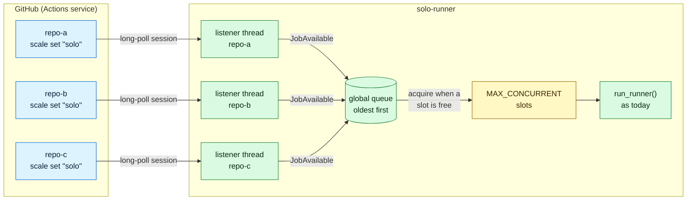

# Proposal: a runner scale set mode for v1.0

Status: **proposal, not built.** Written 2026-11-17 against
[`actions/scaleset`](https://github.com/actions/scaleset) at `716908e`
(2026-11-07, "Public Preview") and solo-runner 0.1.0.

## Summary

GitHub's runner scale set API lets a client long-poll for jobs instead of
listing workflow runs, and lets GitHub do the job-to-runner matching. It works
for repos of a personal account, but only as **one scale set per repo**: there
is no account-wide scale set without an organisation. solo-runner would keep
its reason to exist (one container, one global limit, many repos), and gain
faster pickup, almost no REST traffic and exact job lifecycle events.

**Recommendation:** keep polling as the default for v1.0. Add the scale set
mode as an opt-in `MODE=scaleset`, marked experimental, but only after a short
spike against real GitHub answers the three open questions below. If the
spike fails on question 1 or 2, postpone the mode to 1.x and revisit when
`actions/scaleset` leaves public preview.

## How solo-runner works today

Every `POLL_INTERVAL` seconds the dispatcher lists queued and in-progress runs
of every repo, then their jobs (ETags keep most answers at 304), matches the
job's labels locally (`job_matches`), picks the oldest jobs for the free slots
(`pick_jobs`) and registers a just-in-time runner in that repo. GitHub then
hands *some* matching queued job of that repo to the runner; solo-runner learns
it got one by reading `Running job:` from the runner's output, and removes the
runner after `IDLE_TIMEOUT` if it never got one.

## What a scale set is

A scale set is a named group of ephemeral runners registered at repo, org or
enterprise level. Its name, plus optional extra labels (multiple labels are
supported on github.com; GHES needs 3.18+ and a feature flag), are what
`runs-on` targets. The client:

1. exchanges a PAT or App token for a registration token, then for an admin
   token of the Actions service (`POST /actions/runner-registration`, scoped
   to one config URL, i.e. one repo here);
2. creates or finds the scale set (unique name per runner group; a personal
   repo only has the `default` group);
3. opens a message session for it (one session per scale set at a time) and
   long-polls: the call is held ~50 s and returns `JobAvailable`,
   `JobAssigned`, `JobStarted`, `JobCompleted` messages plus current
   statistics. The client sends its free capacity with every poll
   (`X-ScaleSetMaxCapacity`) so GitHub does not hand it more than it can run;
4. acquires the jobs it wants (`AcquireJobs`); an unacquired job stays
   unassigned;
5. generates a JIT config for the scale set and starts a runner. GitHub
   assigns an acquired job to any idle runner of the set; the runner runs one
   job and is removed.

Messages are acknowledged by deleting them; unacknowledged ones are
redelivered. A job assigned to the set but not picked up by a runner in time
is requeued, up to three times.

## How it would map onto a personal account

- **Discovery stays.** `REPOS`, `REPO_EXCLUDE`, the public-repo refusal and
  `DISCOVERY_INTERVAL` work as now. For each served repo the dispatcher
  ensures a scale set named `RUNNER_NAME_PREFIX` with `LABELS` as extra labels,
  and runs one listener thread. Repos that leave the list get their session
  closed and their scale set deleted.
- **The global limit moves to acquisition.** Each listener reports
  `maxCapacity = free slots` (shared counter). `JobAvailable` messages from all
  repos go into one queue ordered by `queueTime`; a job is acquired only when a
  slot is reserved for it, so oldest-first across repos survives. Because each
  long poll carries the capacity of the moment it was sent (up to ~50 s old),
  the sum over N sessions can overshoot; the queue absorbs that by not
  acquiring, which is why open question 1 matters.
- **The runner part is reused.** `run_runner()` keeps its slot directory, runner
  copy, log pump and cleanup. Only the JIT call changes (scale set endpoint
  instead of `/repos/{repo}/actions/runners/generate-jitconfig`), and
  `JobStarted`/`JobCompleted` replace the `Running job:` heuristic.
- **Shutdown and restarts.** Sessions are deleted on SIGTERM; scale sets stay,
  so jobs queued while the container restarts are waiting for the set, not
  failing with "no runner matches". Stale sessions after `kill -9` expire on
  GitHub's side; at start a `409 Conflict` on session creation is retried.
- **Implementation in the standard library.** There is no Python SDK. The
  protocol is plain HTTPS + JSON (token exchange, scale set CRUD, sessions,
  messages, acquire, JIT config, runner removal), about 400 to 600 lines in a
  new `solo_runner/scaleset.py`, tested against a fake server like the current
  `github.py`. `actions/scaleset` is the reference to follow, and its changes
  have to be tracked by hand.

## Trade-offs

| | Polling (today) | Scale sets |
| --- | --- | --- |
| Pickup latency | up to `POLL_INTERVAL` (30 s) | ~1 s (long poll) |
| REST rate limit | ~2 requests per repo per scan, mostly free 304s | almost none; the Actions service is called with its own token |
| Who matches jobs to runners | solo-runner (`job_matches`), approximated | GitHub, exactly as for any runner |
| Wrong-job / idle runners | possible: a runner for repo-a takes *a* queued job, `IDLE_TIMEOUT` cleans up | none: runners only start for acquired jobs |
| Job lifecycle | log line heuristic | `JobStarted` / `JobCompleted` with result; good input for metrics (backlog item 4) |
| Open connections | none between scans | one long poll per served repo (threads; fine for tens of repos) |
| Global `MAX_CONCURRENT`, oldest first | simple, exact | must be rebuilt on acquire; overshoot possible, see above |
| What appears in repo settings | short-lived JIT runners | one scale set per repo, permanently |
| Several hosts on the same repos | works with distinct prefixes | works: each host has its own set, both carry label `solo` |
| API status | documented REST API | Actions service API, "stable" per `actions/scaleset`, repo in public preview |
| Permissions | Administration RW + Actions R | Administration RW (Actions R no longer needed) |
| GHES | any version | multiple labels need 3.18+ with a flag |
| Code size | ~900 lines | +400 to 600 lines, second mode to test and support |

Security does not change for jobs: runners are the same ephemeral JIT runners
with the same mounts and user, and the dispatcher still strips the token from
their environment. The dispatcher holds one more short-lived credential (the
Actions service admin token per repo). If the mode is built, the README's
Security section gets a paragraph saying so.

## Open questions for the spike

1. **Unacquired jobs.** If a listener acknowledges a `JobAvailable` without
   acquiring it (no free slot), is the job offered again later, and how soon?
   scalerunnergh restarts the session to get such jobs re-offered, which hints
   that it is not automatic. If it is not, oldest-first across repos needs the
   session-restart workaround or has to be dropped.
2. **Assigned but not started.** How long may an acquired job wait for a runner
   before GitHub requeues it, and what happens after the third requeue? This
   decides whether acquiring slightly ahead of free slots is safe.
3. **Labels.** Does `runs-on: [self-hosted, solo]` still match a repo scale set
   named `solo`, or must workflows switch to `runs-on: solo`? ARC
   historically did not match `self-hosted`. If it does not match, the
   migration note in the README must say so loudly.

The spike needs the private test repo and token from the end-to-end test
(backlog item 2) and is about half a day: a throwaway script that creates a
scale set, opens a session, and logs messages while a few jobs are queued.

## Prior art

- [`actions/scaleset`](https://github.com/actions/scaleset): the official Go
  client and its `dockerscaleset` example; reference for the protocol.
- [scalerunnergh](https://github.com/emon5122/scalerunnergh): Go, built on
  `actions/scaleset`, supports repo-level scale sets for user accounts with a
  shared host slot pool. It shows the approach works for personal repos; it
  needs a JSON config listing each scale set, which is where solo-runner's
  discovery would stay different.
- [actions-runner-controller](https://github.com/actions/actions-runner-controller):
  the original user of the API, Kubernetes only.
